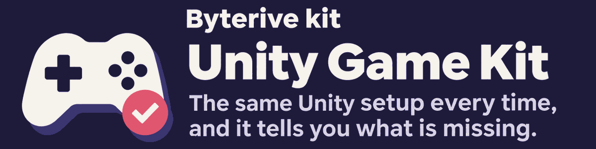
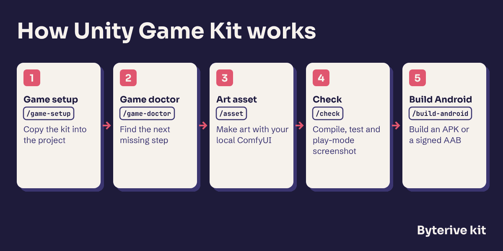
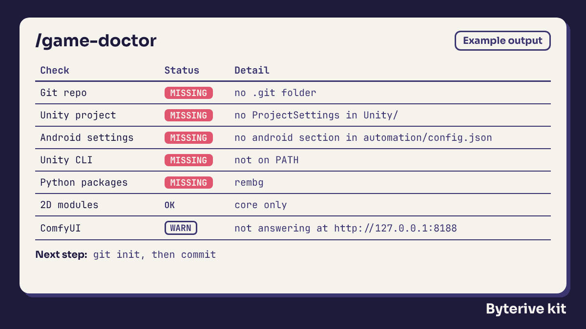

# unity-game-kit

The same Unity setup every time, and it tells you what is missing.

Version 0.2.1 · MIT · Works with Claude Code

## What it does

We built unity-game-kit to set up a Unity game project the same way every time, then check what is still missing. It adds:

- Editor build and check scripts
- an Android build and install pipeline
- a local ComfyUI art pipeline with model comparison
- seven 2D game skills with optional modules
- a doctor that names the next missing step

Scope: Windows, Unity 6, Android.

## How it works



1. `/game-setup` copies the kit into the project.
2. `/game-doctor` finds the next missing step.
3. `/asset` makes art with your local ComfyUI.
4. `/check` runs compile and test checks and takes a play-mode screenshot.
5. `/build-android` builds an APK or a signed AAB.

## Install

```
/plugin marketplace add Byterive/kit
/plugin install unity-game-kit@byterive-kit
```

Pick **project** scope inside each game. After a new version is released: `/plugin marketplace update byterive-kit`.

## Try it

1. `/game-setup`
   It asks the game name, platforms, orientation, art style and 2D modules, copies the kit, and runs the doctor.
2. `/game-doctor`
   It checks the real project and prints a table with the next missing step.
3. `/check`
   It runs the compile and test checks, the level check and a play-mode screenshot, and reports pass or fail with the screenshot.



## What you get

| skill | what it does | result |
|---|---|---|
| `/game-setup` | Asks name, platforms, orientation, art style and 2D modules; copies the kit; runs the doctor | Editor scripts, `automation/`, `gamekit.json`, `.gitignore` lines; existing files are never overwritten |
| `/game-doctor` | Checks the real project: Unity modules, packages, kit scripts, scene, tests, Unity CLI, Python, ComfyUI, Android settings | a table and the next missing step |
| `/check` | Compile errors, tests, level check, play-mode screenshot | pass or fail plus a screenshot |
| `/content-check` | Runs the game's own validator, if it has one | problems found, or clean |
| `/asset` | Art brief, ComfyUI options, you pick, iterate, the approved asset goes into the project | a placed asset |
| `/art-compare` | Checkpoint, LoRA and strength grid on one fixed prompt | labelled grids and a pick |
| `/build-android` | Development APK over USB, or a signed AAB for Google Play | an installed build or a bundle |
| `/store-shots` | Captures and frames store screenshots and the feature graphic | store-ready images |

## The 2D skills

Seven are always on: `2d-code-hygiene`, `2d-game-feel`, `2d-ui-touch-mobile`, `2d-performance-android`, `2d-save-systems`, `2d-art-pipeline` and `2d-level-pacing-prototype`.

`2d-pack-index` loads the optional modules a game lists in `gamekit.json`: camera, audio, shaders, physics tuning, AI pathing, procedural, and at most one genre.

The Google Play figures in the pack are dated 2026-11-04. Check them before you release.

## What runs on your machine

On session start, a hook runs `scripts/doctor.py --brief` (Python standard library only). In a project with a `gamekit.json` it reads your project files, checks whether ComfyUI answers at the address below, and prints one line if setup items need attention. Outside a kit project it stays silent.

The doctor prints install hints as text. It never runs them for you.

More in the [how-to](https://github.com/Byterive/kit/blob/main/docs/howto/02-unity-game-kit.md).

## Needs and limits

- Windows, Unity 6, Python 3, and an Android phone for builds.
- Art generation needs a local ComfyUI and models you download yourself under their own licences. `reference/comfyui-models.md` lists models for a 12 GB GPU and has a licences section.
- ComfyUI runs on your own machine. The kit talks to it only at `http://127.0.0.1:8188`, set in `automation/config.json`.
- Background removal uses `rembg` and `onnxruntime`. You install them yourself with pip (`pip install -r automation/requirements.txt`); the kit does not bundle or auto-install them.
- Privacy: see [PRIVACY.md](PRIVACY.md).

## Tests

```
python scripts/test_modules.py
```

## Licence

License: MIT. Copyright (c) 2026 Junaid Iqbal (Byterive).

Unity, ComfyUI, Android and Google Play are trademarks of their owners; this project is not affiliated with them.

*Independent project by Byterive. Not affiliated with or endorsed by Anthropic.* · [byterive.com](https://byterive.com)
